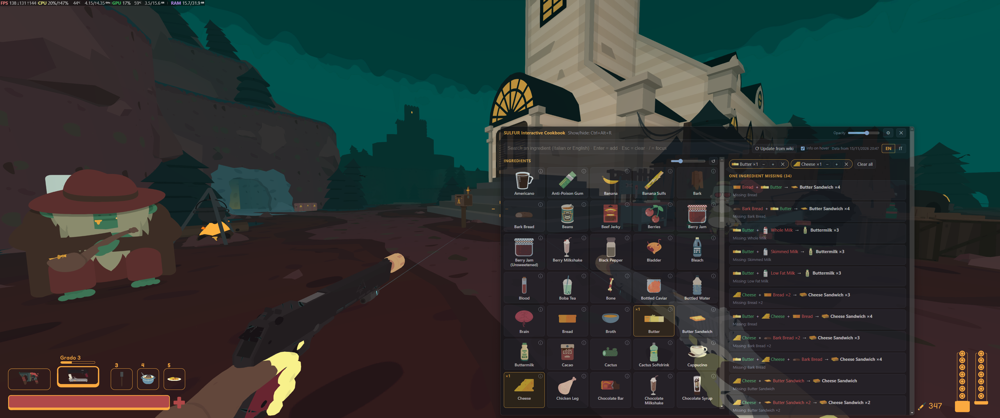

<div align="center">

# SULFUR Interactive Cookbook

**Recipes, ingredients, healing and buffs at a glance — in an overlay you toggle with a hotkey while you play.**

[](https://github.com/SnailMango/sulfur-interactive-cookbook/releases/latest)
[](https://github.com/SnailMango/sulfur-interactive-cookbook/releases)
[](LICENSE)


[**Download**](https://github.com/SnailMango/sulfur-interactive-cookbook/releases/latest) ·
[Report a bug](https://github.com/SnailMango/sulfur-interactive-cookbook/issues/new/choose) ·
[Italiano ↓](#-italiano)

</div>

> **Unofficial fan project.** Not affiliated with or endorsed by Perfect Random. *SULFUR* and all its names, icons and artwork belong to their respective owners. Recipe data comes from the community wiki at <https://sulfur.wiki.gg>.

---

## What is it?

SULFUR has hundreds of ingredients and recipes. Instead of alt-tabbing to the wiki every few minutes to check what you can cook with what you just looted, **SULFUR Interactive Cookbook** puts the whole cookbook one hotkey away, on top of the game.

<!--
Add screenshots here once you have them (put the files in docs/images/):

-->

## Features

- 🍳 **Recipe finder** — pick the ingredients you have (the grid shows every ingredient with its icon, alphabetically) and see what you can cook **now**, what is **one ingredient away**, and every other recipe that uses them. "Any …" ingredient groups are handled automatically.
- ❤️ **Healing and buffs** — hover any dish or ingredient to see how much it heals, how fast, which status effects it removes (Poisoned, Frozen…) and which buffs it gives. Click to pin the card without losing your selected ingredients.
- 🔎 **Search in English or Italian**, by ingredient or by dish name.
- 🪟 **Real overlay** — frameless, always-on-top, adjustable opacity, remembers its position and size. Show/hide with a global hotkey (default **Ctrl + Alt + R**, changeable).
- 🔄 **Always up to date** — recipe data is refreshed from the wiki every week and downloaded by the app automatically; the app itself updates from GitHub Releases.
- 🌍 **English and Italian** — switch instantly with the **EN | IT** buttons. Item names and descriptions can be customised and translated.
- 🔒 **Private and light** — no account, no telemetry. The built-in server only listens on `127.0.0.1`.

## Download and install

1. Open the [**latest release**](https://github.com/SnailMango/sulfur-interactive-cookbook/releases/latest).
2. Download `SULFUR-Interactive-Cookbook-Setup-x.y.z.exe` and run it.
3. Windows may show *"Windows protected your PC"* because the app is not code-signed. Click **More info → Run anyway**.

The app starts in the system tray and shows the overlay right away. Windows 10/11 (64-bit).

## How to use it

| Action | How |
|---|---|
| Show / hide the overlay | **Ctrl + Alt + R** (change it in ⚙ Settings) |
| Hide | ✕ in the title bar, or **Esc** with an empty search box |
| Move / resize | drag the title bar / drag the window edges |
| Opacity | slider in the title bar |
| Pin the stats card | click a dish or ingredient name in a recipe, or the ⓘ on a tile |
| Quit completely | tray icon → **Quit** |

Type an ingredient (or click it in the grid) to add it to your inventory; click it again to add more of it. Use **−/+/✕** on the chips to adjust.

### ⚠️ Important: game display mode

The overlay is an always-on-top window, so it **cannot appear over "Exclusive Fullscreen"**. In SULFUR's graphics options choose **Fullscreen Window / Borderless** — on a modern PC the performance difference is negligible. Alternatively, keep the overlay on a second monitor.

## Updates

- **Recipe data** — checked at startup (every few hours at most) and with the **⟳ Update** button. GitHub Actions re-reads the wiki every Monday.
- **The app** — new versions download in the background and install when you quit (or with *Restart and install* in ⚙ Settings).
- Your own names and translations are stored locally and are never overwritten.

## Languages and translations

The app **starts in English**; switch to Italian (or back) with the **EN | IT** buttons at the top right.

The Italian version exists because the author is Italian and plays SULFUR in Italian — see the [note below](#-italiano). **More languages are welcome!** Open a [translation request](https://github.com/SnailMango/sulfur-interactive-cookbook/issues/new?template=translation_request.yml) or see [CONTRIBUTING.md](CONTRIBUTING.md). Interface texts are easy to translate; item names and effect descriptions ideally come from the game's own localisation, so it helps if you know the in-game names in your language.

## Where is my data?

Tray icon → **Open data folder** (usually under `%APPDATA%`). It contains `it_en.json` (Italian item names), `it_texts.json` (translated effect lines), `it_glossary.json` (status/stat glossary) and `settings.json`. Icons are downloaded from the wiki the first time they are needed and cached in the `icons` subfolder.

**Network use:** `raw.githubusercontent.com` (recipe data), `sulfur.wiki.gg` (icons), GitHub Releases (app updates) and — only if you press *Translate names automatically* — `api.mymemory.translated.net` (it receives only the English item names).

## Troubleshooting

- **The overlay does not appear over the game** → the game is in Exclusive Fullscreen (see above).
- **The hotkey does nothing** → another program uses it; pick another one in ⚙ Settings.
- **"Could not download the data"** → check your connection and try **⟳ Update** again later.
- **Some icons are missing** → the wiki rate-limits requests; wait a minute and reopen the overlay.
- **A recipe or effect looks wrong** → compare it with <https://sulfur.wiki.gg> first: the data comes from there. If the wiki is right and the app is wrong, [open an issue](https://github.com/SnailMango/sulfur-interactive-cookbook/issues/new/choose).

## For developers

```bash
npm install     # install the dependencies (Node.js 20+)
npm start       # run the app in development
npm run dist    # build the Windows installer into dist/
python tools/scrape.py   # regenerate data/recipes.json from the wiki (Python 3.8+)
```

```
src/main.js          overlay window, global hotkey, tray, app updates
src/server.js        local server (127.0.0.1): data from GitHub, icon cache, names/translations
src/preload.js       safe bridge between window and app
renderer/index.html  the user interface
tools/scrape.py      wiki → data/recipes.json (runs on GitHub Actions)
data/recipes.json    published data the app downloads
.github/workflows    weekly data refresh + release builds
```

Icons are **not** redistributed in this repository: each app downloads them from the wiki on demand.

## Credits and licences

- Code: [MIT](LICENSE).
- Recipe data and descriptions: community wiki <https://sulfur.wiki.gg> — please check the licence shown in the wiki footer (usually CC BY-SA) and keep the attribution.
- *SULFUR* names, icons and images: © Perfect Random.
- Automatic name translation (optional): [MyMemory](https://mymemory.translated.net).

---

<a id="-italiano"></a>

# 🇮🇹 Italiano

> **Perché c'è anche l'italiano?** Sono italiano e gioco a SULFUR in italiano: ho creato questa utility nella mia lingua, oltre che in inglese, per rendermi la vita più facile durante il gioco. L'app **parte in inglese** (la lingua più usata), ma con i pulsanti **EN | IT** in alto a destra passi all'italiano in qualsiasi momento. Se ti serve un'altra lingua, **possiamo aggiungerla**: leggi [CONTRIBUTING.md](CONTRIBUTING.md) o apri una [richiesta di traduzione](https://github.com/SnailMango/sulfur-interactive-cookbook/issues/new?template=translation_request.yml).

**SULFUR Interactive Cookbook** è un overlay non ufficiale per **SULFUR** (Perfect Random): ricette, ingredienti, cure e buff sempre a portata di scorciatoia, sopra il gioco, senza alt-tab né browser.

### Funzioni
- 🍳 **Cosa posso cucinare** — scegli gli ingredienti che hai (griglia alfabetica con icone) e vedi cosa puoi cucinare subito, cosa ti manca per una ricetta e tutte le altre combinazioni. I gruppi "Any …" sono gestiti da soli.
- ❤️ **Cure e buff** — passa il mouse su un piatto o un ingrediente per vedere quanta vita cura, in quanto tempo, quali stati rimuove (avvelenato, congelato…) e quali buff dà. Con un clic fissi la scheda senza perdere gli ingredienti scelti.
- 🔎 **Ricerca in italiano e inglese**, per ingrediente o per nome del piatto.
- 🪟 **Vero overlay** — senza bordi, sempre in primo piano, trasparenza regolabile, ricorda posizione e dimensione. Si mostra/nasconde con una scorciatoia globale (predefinita **Ctrl + Alt + R**, modificabile).
- 🔄 **Sempre aggiornato** — i dati delle ricette vengono riletti ogni settimana dalla wiki e scaricati dall'app; anche l'app si aggiorna da sola tramite le Release di GitHub.
- 🌍 **Inglese e italiano** — nomi degli oggetti, descrizioni, cure e buff modificabili e traducibili.
- 🔒 **Privata e leggera** — nessun account né telemetria; il server interno ascolta solo su `127.0.0.1`.

### Installazione
1. Vai alla [**release più recente**](https://github.com/SnailMango/sulfur-interactive-cookbook/releases/latest).
2. Scarica `SULFUR-Interactive-Cookbook-Setup-x.y.z.exe` e avvialo.
3. Windows può mostrare *"Windows ha protetto il PC"* perché l'app non è firmata: clicca **Ulteriori informazioni → Esegui comunque**.

### Uso
| Azione | Come |
|---|---|
| Mostra / nascondi | **Ctrl + Alt + R** (cambiabile da ⚙ Impostazioni) |
| Nascondi | ✕ nella barra, oppure **Esc** con la ricerca vuota |
| Sposta / ridimensiona | trascina la barra / trascina i bordi |
| Trasparenza | cursore nella barra |
| Fissa la scheda statistiche | clic sul nome di un piatto o ingrediente in una ricetta, oppure ⓘ su una tile |
| Chiudi del tutto | icona nella barra di sistema → **Esci** |

> ⚠️ **Importante:** l'overlay è una finestra sempre in primo piano, quindi **non compare sopra lo "Schermo intero esclusivo"**. In SULFUR scegli **Finestra senza bordi (Fullscreen Window)** nelle opzioni grafiche: la differenza di prestazioni è trascurabile su un PC recente. In alternativa tienilo sul secondo monitor.

### Nomi e traduzioni in italiano
Passa a **IT**: compare una matita ✎ su ogni ingrediente (e nella scheda di ogni piatto) per scrivere il nome italiano del gioco. Il pulsante **Traduzioni** elenca nomi ed effetti ancora senza traduzione, con un campo per ciascuno e la traduzione automatica facoltativa dei nomi. Le tue traduzioni restano sul tuo PC e non vengono toccate dagli aggiornamenti.

### Aggiornamenti e dati
Dati: controllo all'avvio e con **⟳ Aggiorna**. App: scarica in background e si installa alla chiusura. I tuoi dati stanno nella cartella aperta da icona nella barra → **Apri la cartella dei dati**.

### Problemi comuni
- **Non compare sopra il gioco** → il gioco è in schermo intero esclusivo.
- **La scorciatoia non funziona** → è usata da un altro programma: cambiala da ⚙ Impostazioni.
- **"Impossibile scaricare i dati"** → controlla la connessione e riprova più tardi con **⟳ Aggiorna**.

### Crediti e licenze
Codice sotto licenza [MIT](LICENSE). Dati dalla community wiki <https://sulfur.wiki.gg> (controlla la licenza indicata nel footer della wiki e mantieni l'attribuzione). Nomi, icone e immagini di SULFUR © Perfect Random. Progetto non ufficiale e non affiliato.
